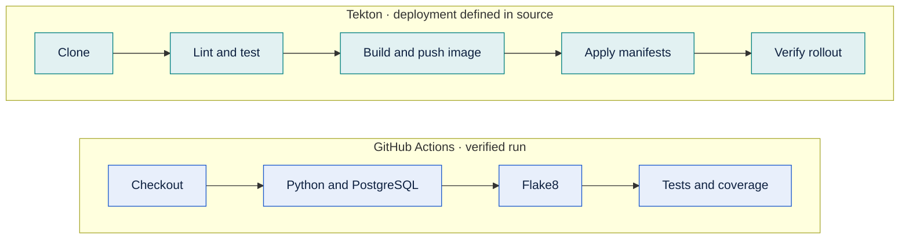

# IBM DevOps Engineering: An End-to-End Learning Case Study

**Soham Prasanna Moholkar**  
IBM on Coursera · Learning portfolio: 31 October–18 November 2026  
Evidence reviewed: 19 November 2026

> **The project:** connect Agile planning, Git collaboration, Python application development, automated testing, security, containers and deployment automation through a customer Accounts microservice, supported by earlier IBM course assignments.
>
> **Verified capstone CI result:** 33 tests passed · 98% reported coverage · 0 Flake8 findings. These results describe one recorded CI execution, not production performance.

**Jump to** [Project map](#2-project-map) · [All 15 courses](#3-all-15-courses-in-the-case-study) · [Accounts API](#4-main-implementation-customer-accounts-service) · [Delivery pipeline](#delivery-flow) · [Verified results](#6-results-and-evidence) · [Evidence index](#9-evidence-index-and-provenance)

## Executive summary

The IBM learning programme covered 15 courses. The engineering challenge was to connect their individual practices into a delivery process that another developer could inspect and reproduce. A working API alone would not demonstrate that process. The portfolio also needed traceable requirements, repeatable tests, a defined runtime, security controls and a clear deployment path.

The strongest implementation sits in [github-final-project](https://github.com/Soham-Moholkar/github-final-project). Although its name comes from the GitHub assignment, it now contains the Accounts service, CI workflow, Dockerfile, Kubernetes manifests and Tekton CD pipeline. This case study uses that repository as its central implementation and connects it to the calculator, emotion detection and counter-service assignments.

The result is a learning portfolio with verifiable source code and CI outcomes. The reviewed GitHub Actions execution tests the Accounts service against PostgreSQL and passes its configured 95% coverage requirement. Kubernetes and Tekton definitions describe the deployment process. A live cluster rollout, public production endpoint, availability target and operational improvement measurements are outside the evidence reviewed here.

## 1. Context, objective and role

**Context.** The supplied presentation reports completion of all 15 courses, an unweighted mean grade of 97.13%, four perfect scores and a capstone grade of 96.08%. These are portfolio-reported course results. They are separate from the engineering measures obtained from GitHub Actions.

**Objective.** Build a coherent delivery story around a REST microservice: define work as user stories, implement customer-account operations, test expected and failure behaviours, automate checks, package the application and define deployment to Kubernetes.

**Role and attribution.** Soham's portfolio contains individual course exercises and adaptations of IBM teaching repositories. The Accounts application builds on the IBM DevOps capstone starter by John Rofrano. The emotion detection application builds on IBM Developer Skills Network material. This is a student engineering case study rather than a claim of an IBM employment engagement or a commercial customer delivery. Existing licenses and authorship notices remain applicable.

**Success criteria.** The Accounts API should implement create, list, read, update and delete operations with consistent HTTP responses. Automated checks should lint the service and tests, run against a database, and enforce at least 95% coverage. Packaging and deployment configuration should be versioned alongside the application.

## 2. Project map

| Project | Purpose in the learning journey | Evidence and outcome |
| --- | --- | --- |
| [GitHub assignment and Accounts capstone](https://github.com/Soham-Moholkar/github-final-project) | Main delivery case: account lifecycle, planning, tests, security, CI, containers and CD definitions | CRUD implementation, ten closed user stories, passing CI, deployment manifests and Tekton pipeline |
| [Git and GitHub exercises](https://github.com/Soham-Moholkar/mcino-Introduction-to-Git-and-GitHub) | Practice repository structure and contribution conventions | Simple-interest Bash script, compound-interest Python script, contribution guide, code of conduct and issue templates |
| [Flask and Watson emotion detection](https://github.com/Soham-Moholkar/oaqjp-final-project-emb-ai) | Turn an external AI capability into a web application | Python package, Flask routes, browser form, five-emotion tests and invalid-input handling |
| [Module 8 application repository](https://github.com/Soham-Moholkar/ibm-devops-module-8-) | Related emotion detection assignment artifact | Matching application package, server, browser assets and tests. Treated as related evidence, not a second independent AI system |
| [CI/CD counter service](https://github.com/Soham-Moholkar/ibm-ci-cd-practice) | Isolate automation around a small REST service | GitHub Actions lint/test/image-build jobs, Tekton tasks and OpenShift deployment script. Recorded CI succeeded |
| [DevOps capstone workspace](https://github.com/Soham-Moholkar/devops-capstone-project) | Retain the capstone starter and related work | Accounts model/service layout, tests and Tekton artifacts. The more complete reviewed delivery implementation is in `github-final-project` |
| [Agile planning lab](https://github.com/Soham-Moholkar/lab-agile-planning) | Planning exercise repository | A README is present. The reviewed issue endpoint returned no issues, so the concrete planning evidence below comes from the Accounts repository |

## 3. All 15 courses in the case study

The course names below follow the supplied portfolio. Each entry states its contribution to the case and the boundary of the available evidence.

### 01 · Introduction to DevOps

**Problem:** code, testing and deployment can become disconnected activities. **Application:** the Accounts repository keeps application code, quality checks and deployment definitions together. Its issue backlog connects functional work with technical work such as CI and containerization. **Learning:** delivery quality depends on the whole change process. A passing test stage is useful evidence, while deployment still needs its own execution record.

### 02 · Introduction to Cloud Computing

**Problem:** developers need to understand which responsibilities remain with an application team when using managed infrastructure. **Application:** the service separates application configuration from the runtime through environment variables and provides Kubernetes manifests. **Learning:** a managed cluster does not remove responsibility for persistent data, access, configuration and recovery. The reviewed material demonstrates a cloud-oriented deployment design, not a verified cloud availability outcome.

### 03 · Agile Development and Scrum

**Problem:** a broad instruction to “complete the service” is difficult to implement and assess. **Application:** ten Accounts issues split the work into environment setup, account operations, CI, security, Docker, Kubernetes and CD automation. Issue descriptions include roles, needs, acceptance criteria, sprint assignments and estimates. All ten are closed in the reviewed snapshot. **Learning:** acceptance criteria create a bridge between a requirement and a test. Closed issues record project state but do not independently prove a successful cluster rollout. [Planning evidence](https://github.com/Soham-Moholkar/github-final-project/issues?q=is%3Aissue)

### 04 · Introduction to Software Engineering

**Problem:** mixing storage, HTTP handling and configuration makes a service harder to change. **Application:** the Accounts implementation separates its persistent model in `service/models.py`, routes in `service/routes.py`, configuration and shared error/logging handlers. Tests mirror these responsibilities. **Learning:** clear boundaries make changes easier to verify and explain. The structure extends IBM's provided starter architecture rather than representing a framework built from scratch.

### 05 · Getting Started with Git and GitHub

**Problem:** assignments need inspectable history and contribution conventions. **Application:** the calculator repositories contain source files, licenses, contribution instructions and issue templates. The Accounts repository adds user stories and a CI badge. Recent commits document API/security work, a runner compatibility change and a complete Tekton pipeline. **Learning:** a repository communicates both the implementation and how to work on it. This case does not infer a peer-review process solely from the presence of GitHub files.

### 06 · Hands-on Introduction to Linux Commands and Shell Scripting

**Problem:** repeated environment and deployment steps are easy to perform inconsistently. **Application:** the portfolio contains Bash calculator and setup scripts. The counter-service deployment script applies Tekton resources and starts a pipeline with repository, branch, application and image parameters. **Learning:** shell scripts make operational steps explicit. The script's existence documents automation intent, while runtime logs would be required to demonstrate execution in OpenShift. [Deployment script](https://github.com/Soham-Moholkar/ibm-ci-cd-practice/blob/main/bin/deploy.sh)

### 07 · Python for Data Science, AI and Development

**Problem:** application logic needs dependable data handling, functions and error behaviour. **Application:** Python supports the compound-interest exercise, the emotion detection package and the Accounts service. The emotion detector constructs a request, extracts five scores and calculates the dominant emotion. **Learning:** foundational Python skills transfer into API integration and service development. The reviewed repositories do not establish a separate NumPy/pandas analysis project, so none is claimed here.

### 08 · Developing AI Applications with Python and Flask

**Problem:** users need a simple interface to an external NLP service. **Application:** a browser form sends text to Flask's `/emotionDetector` route, which calls the Skills Network Watson NLP emotion endpoint. The package returns anger, disgust, fear, joy and sadness scores plus the dominant emotion. HTTP 400 responses produce empty results that the server turns into an invalid-text message. The request has a 30-second timeout. **Learning:** model access is only one part of an application. Input handling, response formatting and service availability affect its usability. The five dominant-emotion tests depend on the lab service, and no fresh successful execution is claimed here. [Application source](https://github.com/Soham-Moholkar/oaqjp-final-project-emb-ai/blob/main/EmotionDetection/emotion_detection.py)

### 09 · Introduction to Containers with Docker, Kubernetes and OpenShift

**Problem:** an application needs a defined runtime and a reproducible deployment description. **Application:** the Accounts Dockerfile uses Python 3.9, installs dependencies, runs Gunicorn on port 8080 and switches to UID 1001. The Kubernetes deployment defines one replica, resource requests/limits, readiness and liveness probes, and a non-root security context. A ClusterIP Service exposes port 8080 inside the cluster. **Learning:** image packaging, readiness and networking solve different problems. The supplied demo uses SQLite under `/tmp`; pod replacement can lose its data. [Dockerfile](https://github.com/Soham-Moholkar/github-final-project/blob/main/Dockerfile), [Deployment](https://github.com/Soham-Moholkar/github-final-project/blob/main/deploy/deployment.yaml)

### 10 · Application Development using Microservices and Serverless

**Problem:** a service should expose a focused capability through a stable interface. **Application:** the Accounts API owns customer-account lifecycle operations. The counter service and the emotion application provide separate learning examples with different responsibilities. **Learning:** a useful boundary follows the capability and its data. These repositories demonstrate small services and API contracts. A deployed function, event bus or serverless workload was not present in the reviewed artifacts, so serverless remains course learning rather than a claimed deployment result.

### 11 · Introduction to Test and Behavior Driven Development

**Problem:** CRUD code needs protection against regressions and invalid requests. **Application:** the Accounts suite covers persistence, serialization, missing records, invalid payloads, unsupported media types, idempotent deletion, security headers and CORS. User-story acceptance criteria use Given/When/Then language. **Outcome:** the inspected CI execution ran 33 tests successfully and reported 98% combined statement/branch coverage. Configuration enforces a 95% minimum. **Learning:** tests should demonstrate behaviour and failure handling. Final code and logs establish the suite's behaviour; they do not prove the chronological red/green/refactor sequence or a separate automated BDD runner. [Coverage configuration](https://github.com/Soham-Moholkar/github-final-project/blob/main/setup.cfg)

### 12 · Continuous Integration and Continuous Delivery

**Problem:** quality checks should run consistently on changes, and deployment steps should be repeatable. **Application:** Accounts CI triggers on pushes and pull requests to `main`, with a manual trigger available. It starts PostgreSQL 15, installs Python 3.9 dependencies, runs Flake8 and executes nosetests. The separate Tekton definition clones, lints, tests, builds/pushes an image, applies manifests, updates the image and waits for rollout. The counter project provides another Actions/Tekton/OpenShift exercise. **Outcome:** the inspected Accounts and counter CI runs succeeded. **Learning:** a successful CI run proves the stages it executed. It does not prove the separately defined Tekton pipeline ran. [Accounts CI](https://github.com/Soham-Moholkar/github-final-project/blob/main/.github/workflows/ci-build.yaml), [Tekton CD](https://github.com/Soham-Moholkar/github-final-project/blob/main/tekton/pipeline.yaml)

### 13 · Application Security and Monitoring / DevSecOps

**Problem:** web service behaviour and runtime permissions need deliberate controls. **Application:** Accounts initializes Flask-Talisman and Flask-CORS, and tests response headers and preflight behaviour. Its container uses a non-root user, while Kubernetes drops Linux capabilities and prevents privilege escalation. **Learning:** these are implemented controls with a defined scope. The lab disables forced HTTPS and allows broad CORS defaults. Authentication, authorization, strict origin policy and automated SAST/SCA/DAST gates would require further work and evidence. No completed scan programme is claimed. [Application initialization](https://github.com/Soham-Moholkar/github-final-project/blob/main/service/__init__.py)

### 14 · Monitoring and Observability for Development and DevOps

**Problem:** deployment configuration needs a way to tell whether the process is responding. **Application:** the service has `/health`, application logging, Gunicorn access logging and Kubernetes probes. Tekton includes rollout status verification. **Learning:** these provide a starting point for operation. `/health` returns a process-level status and does not actively verify database readiness. Reviewed artifacts do not establish a metrics dashboard, distributed tracing, SLO alerts or measured recovery time. These are the next operational extensions rather than completed outcomes.

### 15 · DevOps Capstone Project

**Problem:** integrate the preceding skills into an assessable delivery system. **Application:** extend the Accounts starter into a complete CRUD service, describe work through user stories, add security behaviour and tests, automate PostgreSQL-backed CI, and version Docker/Kubernetes/Tekton configuration. **Outcome:** the portfolio reports a 96.08% capstone course grade, and the reviewed engineering evidence independently shows successful CI with 33 tests and 98% coverage. **Learning:** a strong capstone explains which stages ran and which stages are represented by configuration, then makes both easy to inspect.

## 4. Main implementation: customer Accounts service

### User need and API contract

A customer-service representative needs to manage account details without changing application code or accessing database tables directly. The service exposes an HTTP interface over a model containing account ID, name, email, address, optional phone number and join date.

| Operation | Endpoint | Expected behaviour |
| --- | --- | --- |
| Create | `POST /accounts` | Return 201 and a Location header |
| List | `GET /accounts` | Return 200 and a JSON array |
| Read | `GET /accounts/{id}` | Return 200, or 404 if absent |
| Update | `PUT /accounts/{id}` | Return 200 with saved details, or 404 if absent |
| Delete | `DELETE /accounts/{id}` | Return 204, including repeated deletion |
| Health | `GET /health` | Return 200 with process-level status |

### Architecture and data flow

1. A client sends an HTTP request to the Flask application.
2. Route handlers validate the media type and deserialize account data.
3. The SQLAlchemy Account model performs persistence operations.
4. The service serializes a JSON response and returns an appropriate HTTP status.
5. Shared handlers format errors and logs. Talisman and CORS affect HTTP response behaviour.

PostgreSQL is the database used by GitHub Actions. The checked-in Kubernetes demo uses SQLite instead. That distinction matters: the CI run verifies PostgreSQL-backed behaviour, while the demo manifest prioritizes a self-contained lab setup over durable storage.

### Delivery flow



**Continuous integration, executed:** GitHub push/PR → checkout → Python setup → PostgreSQL-backed dependency/test environment → Flake8 → nosetests and coverage gate.

**Continuous delivery, defined:** Tekton clone → lint → tests using in-memory SQLite → Kaniko image build/push → apply Kubernetes manifests → set the image → wait for rollout → print deployment resources.

The pipeline definition has an explicit 180-second rollout timeout. Its sample image reference uses a local registry and a mutable `latest` tag. Its Kaniko task permits an insecure registry, reflecting a lab configuration. A stronger release process would use a trusted registry, an immutable image digest, durable PostgreSQL configuration and a retained deployment record.

### Decisions and tradeoffs

| Decision | Benefit in this project | Tradeoff or follow-up |
| --- | --- | --- |
| Retain the IBM Python 3.9/nosetests toolchain | Matches course dependencies and recorded CI | Modernize and revalidate the toolchain as a separate change |
| Use PostgreSQL in CI | Exercise the service with the intended relational database family | Keep database configuration consistent across later deployment tests |
| Keep a SQLite demo deployment | Make a small lab deployment self-contained | Replace ephemeral storage before using persistent customer data |
| Run the app as a non-root user | Reduce application runtime privileges | Review pipeline and cluster privileges separately |
| Check probes and rollout status | Add process health and deployment feedback | Add dependency-aware readiness and application smoke tests |
| Keep CI and Tekton definitions in Git | Make delivery steps reviewable | Record execution provenance before claiming a deployed release |

## 5. A concrete iteration: CI compatibility

The reviewed history shows an initial API/security/CI commit whose Actions run failed, followed by a commit titled “Pin CI runner to Ubuntu 22.04 for course Python 3.9 compatibility.” The next recorded run succeeded, and subsequent reviewed runs also succeeded.

This sequence supports a concrete learning point: the execution environment is part of reproducibility. A runner pin made the course environment explicit. The earlier failing job's detailed logs were not reviewed for this case, so the commit title and subsequent successful run establish the recorded response without asserting a fully diagnosed root cause. [Failed run](https://github.com/Soham-Moholkar/github-final-project/actions/runs/44353810897), [Runner change](https://github.com/Soham-Moholkar/github-final-project/commit/ff3d8b1e193cee773f6ea0f0c1eb6eff59f97904), [Subsequent successful run](https://github.com/Soham-Moholkar/github-final-project/actions/runs/44354205606)

## 6. Results and evidence

| Measure | Observed result | Interpretation |
| --- | --- | --- |
| Accounts tests | 33 passed | Historical CI job executed successfully |
| Accounts coverage | 98% reported | Combined statement/branch report, rounded by the tool; exceeds the configured 95% gate |
| Flake8 | 0 findings | Lint check for `service` and `tests` passed in the inspected job |
| Planning backlog | 10 of 10 reviewed issues closed | Repository planning state, not independent runtime proof |
| Account operations | Create, list, read, update, delete | Present in source and covered by the recorded tests |
| Counter CI | Successful run | Its Actions workflow includes lint, tests and an image-build job |
| Container/deployment assets | Dockerfile, Deployment, Service and Tekton pipeline | Versioned implementation and deployment configuration |
| Course completion | 15 courses, 97.13% mean grade | Reported by the supplied learning portfolio, separate from software test coverage |

**Primary engineering record:** [Accounts CI run 44360229468](https://github.com/Soham-Moholkar/github-final-project/actions/runs/44360229468), source commit [`6cbfc82`](https://github.com/Soham-Moholkar/github-final-project/tree/6cbfc82e8bbc9d1d37f9efa39db8526c758c3ae3), executed on 18 November 2026. The reviewed build job reports `TOTAL 249 statements, 5 missed, 26 branches, 1 partial branch, 98%` and `Ran 33 tests ... OK`.

**Supporting automation record:** [Counter CI run 44327056109](https://github.com/Soham-Moholkar/ibm-ci-cd-practice/actions/runs/44327056109), source commit [`d0e9be9`](https://github.com/Soham-Moholkar/ibm-ci-cd-practice/tree/d0e9be94bcc9423d07453a998222e078ba859890), executed on 18 November 2026.

No deployment-frequency, lead-time, change-failure-rate, recovery-time, cost-saving or user-adoption result is available in the reviewed evidence. The portfolio demonstrates implementation and learning outcomes without assigning invented business impact.

## 7. Reproduction and deployment review path

Use the recorded Accounts commit for comparison with the historical CI results. The following commands are a review path from the repository's documented setup, not a claim that this case-study preparation reran the service or deployed a cluster.

```bash
git clone https://github.com/Soham-Moholkar/github-final-project.git
cd github-final-project
git checkout 6cbfc82e8bbc9d1d37f9efa39db8526c758c3ae3

# In Bash with Python 3.9 available:
python -m venv venv
source venv/bin/activate
pip install -r requirements.txt

# Local demonstration database; CI uses PostgreSQL instead.
export DATABASE_URI=sqlite:////tmp/accounts.db
flake8 service tests --count --show-source --statistics
nosetests -vv -s tests/test_cli_commands.py tests/test_common.py tests/test_models.py tests/test_routes.py
flask run --host 0.0.0.0 --port 8080
```

Container and cluster review requires a compatible Docker/Kubernetes environment and an image accessible to the cluster. Review `Dockerfile`, `deploy/` and `tekton/` before applying them. A local `docker build` alone does not make the image available to a remote cluster. Review the repository README for the demonstration workflow and the pipeline's registry, storage and service-account settings for the intended lab environment.

## 8. Next engineering iteration

1. **Retain deployment proof.** Capture a Tekton PipelineRun result, image digest, rollout status, resource snapshot and API smoke-test output for the same source revision.
2. **Make data durable.** Configure external PostgreSQL, secret references, migrations and a tested backup/restore process.
3. **Tighten the service boundary.** Add authentication/authorization, restrict browser origins and validate HTTPS configuration at ingress.
4. **Extend release checks.** Add dependency and image scanning, retain results, and define release acceptance criteria.
5. **Operate against explicit targets.** Add request/error/latency metrics, dependency-aware readiness, traces where useful, alert rules and an exercised rollback procedure.

These are proposed improvements. They are not represented as completed project features.

## 9. Evidence index and provenance

| Evidence | Link |
| --- | --- |
| Accounts source snapshot | [Commit 6cbfc82](https://github.com/Soham-Moholkar/github-final-project/tree/6cbfc82e8bbc9d1d37f9efa39db8526c758c3ae3) |
| REST routes | [service/routes.py at reviewed commit](https://github.com/Soham-Moholkar/github-final-project/blob/6cbfc82e8bbc9d1d37f9efa39db8526c758c3ae3/service/routes.py) |
| Security initialization | [service/__init__.py at reviewed commit](https://github.com/Soham-Moholkar/github-final-project/blob/6cbfc82e8bbc9d1d37f9efa39db8526c758c3ae3/service/__init__.py) |
| Coverage gate | [setup.cfg at reviewed commit](https://github.com/Soham-Moholkar/github-final-project/blob/6cbfc82e8bbc9d1d37f9efa39db8526c758c3ae3/setup.cfg) |
| PostgreSQL CI | [ci-build.yaml at reviewed commit](https://github.com/Soham-Moholkar/github-final-project/blob/6cbfc82e8bbc9d1d37f9efa39db8526c758c3ae3/.github/workflows/ci-build.yaml) |
| Test execution and coverage | [Successful CI run and job logs](https://github.com/Soham-Moholkar/github-final-project/actions/runs/44360229468/job/134999244053) |
| Container runtime | [Dockerfile at reviewed commit](https://github.com/Soham-Moholkar/github-final-project/blob/6cbfc82e8bbc9d1d37f9efa39db8526c758c3ae3/Dockerfile) |
| Kubernetes configuration | [deploy directory at reviewed commit](https://github.com/Soham-Moholkar/github-final-project/tree/6cbfc82e8bbc9d1d37f9efa39db8526c758c3ae3/deploy) |
| CD configuration | [tekton directory at reviewed commit](https://github.com/Soham-Moholkar/github-final-project/tree/6cbfc82e8bbc9d1d37f9efa39db8526c758c3ae3/tekton) |
| User stories | [Accounts issues](https://github.com/Soham-Moholkar/github-final-project/issues?q=is%3Aissue), [Kanban project linked by the README](https://github.com/users/Soham-Moholkar/projects/3) |
| Earlier CI/CD assignment | [Counter source snapshot](https://github.com/Soham-Moholkar/ibm-ci-cd-practice/tree/d0e9be94bcc9423d07453a998222e078ba859890) |
| AI/Flask assignment | [Emotion detection source snapshot](https://github.com/Soham-Moholkar/oaqjp-final-project-emb-ai/tree/d947e795f4fa6e16c8ec849e249e93975a8ec96a) |
| Git assignment | [Git/GitHub exercises](https://github.com/Soham-Moholkar/mcino-Introduction-to-Git-and-GitHub) |
| Course grades and curriculum | Supplied `IBM_DevOps_15_Course_Learning_Portfolio.pptx`, slides 1–3 and 12. The presentation's certificate links were not independently revalidated for this case study |

Repository files and issue/run metadata were inspected on 19 November 2026. The Kanban link is included as the README's navigation reference; its live board state was not independently inspected. Runtime results in this case refer to existing recorded GitHub Actions executions. No new cluster deployment or production benchmark formed part of preparing this document.

---

**Portfolio conclusion.** This work connects course foundations to a concrete, testable service and a versioned delivery process. Its strongest demonstrated outcome is a reproducible quality check backed by real CI logs. The next step is to extend that same evidence discipline through deployment and operation.